> Current verification: BACKUP-RESTORE.md documents physical restore drills. INVENTORY-RECOVERY.md describes optional durable_mock with an independent ledger; stock-reset statements below refer to the unchanged default mock. Replay bodies now expire after configurable 24 hours; schedule purge_replay_bodies hourly while retaining tombstones/history/audit. Latest evidence: VERIFICATION-RESULTS.md.

# Persistent Clinic storage

Set `CLINIC_DATA_BACKEND=database` to select PersistentClinicRepository. The default remains `mock` for isolated demonstrations and original contract fixtures. The selector fails startup for unknown values. Domain rules remain in ClinicService; views do not own ORM business logic.

## SQLite development

```ini
CLINIC_DATA_BACKEND=database
DB_ENGINE=django.db.backends.sqlite3
DB_NAME=framework.sqlite3
REGISTRAR_BACKEND=mock
INVENTORY_BACKEND=mock
```

Install backend/requirements.txt, migrate, then start Django. A private development signing key is generated once in ignored `.development-secret`; production requires its own explicit secret.

## PostgreSQL

Install backend/requirements-finals.txt and create a private database/user with appropriate privileges. Example settings, with credentials supplied privately:

```ini
CLINIC_DATA_BACKEND=database
DB_ENGINE=django.db.backends.postgresql
DB_NAME=clinic_db
DB_USER=clinic_app
DB_PASSWORD=your-private-password
DB_HOST=127.0.0.1
DB_PORT=5432
```

Run `python manage.py migrate --noinput`. PostgreSQL support does not import Registrar identities or Inventory stock tables. External identifiers are opaque strings, not cross-module foreign keys. Mock external workspaces remain available independently of Clinic database mode; MOCK_WORKSPACES_ENABLED can explicitly disable those demonstration routes. No real adapters are implemented.

HealthRecord, Consultation, HealthStatus and MedicineDispensation are durable in database mode. Database constraints enforce valid status/measurements/positive quantities and unique nonempty Inventory deduction references. Transactions and row locks serialize writes; a shared database mutex also acquires a SQLite write lock before reads. Optional If-Match/X-Record-Version rejects stale edits. Without those headers, legacy writes retain transactional last-write semantics.

## Current ERD

```mermaid
erDiagram
    AUTH_USER ||--o| OWNER_REGISTRATION : protected_owner
    HEALTH_RECORD {
        bigint health_record_id PK
        string student_id "Registrar reference"
        datetime updated_at
    }
    CONSULTATION {
        bigint consultation_id PK
        string student_id "Registrar reference"
        datetime consulted_at
    }
    HEALTH_STATUS {
        bigint status_id PK
        string student_id "Registrar reference"
        string status
    }
    MEDICINE_DISPENSATION {
        bigint dispensation_id PK
        string student_id "Registrar reference"
        string medicine_id "Inventory reference"
        string inventory_transaction_id UK
        string rollback_transaction_id
        int quantity
        string status
    }
    OPERATION_RECEIPT {
        bigint id PK
        string scope "Actor-method-path digest"
        string key "Unique with scope"
        string fingerprint
        json response "Sensitive replay data"
    }
    AUDIT_EVENT {
        bigint id PK
        string actor_id "Retained metadata, not FK"
        string path "Route template, no medical body"
        int status_code
    }
    INTEGRATION_INCIDENT {
        bigint id PK
        string transaction_id
        string operation
        boolean resolved
    }
    MUTATION_LOCK {
        string name PK
    }
```



There are intentionally no Registrar/Inventory entity relationships. Existing Clinic ORM models were reused; migrations0006–0008 add constraints, replay/audit/incident infrastructure and empty-response support. Back up existing databases before migration and resolve invalid/duplicate legacy rows if constraints reject them. Do not silently discard records. Existing in-memory clinical data is not automatically imported into database mode.

## Restart verification

`scripts/verify_persistence.py write` creates validation rows for all four resource kinds and an Inventory transaction reference. Run it only against a disposable migrated database. Stop/restart PostgreSQL, then run `scripts/verify_persistence.py read` in a fresh application process. This was executed against an isolated PostgreSQL17 instance; all four records and the unchanged reference survived. Separate SQLite process write/read also passed. No stock persistence is claimed: external mocks reset independently, so historical rollback after an external mock restart requires reconciliation rather than guessing a transaction.

Back up the authentication/business database together, protect receipt responses as medical data, and define retention before real use. Metadata audit and incident tables outlive deletion of individual clinical entries. They are not a substitute for access-controlled off-host backups or tamper-evident logging.
