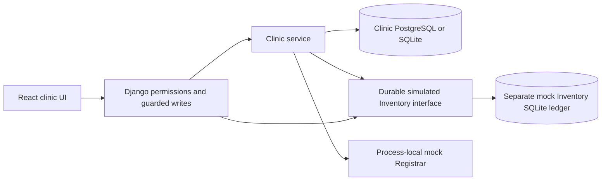

# Durable simulated Inventory and recovery

This is a **MOCK Inventory provider**, not the college Inventory System. No live
provider contract, endpoint, credentials or connectivity is implemented.

Select `INVENTORY_BACKEND=durable_mock`; optionally set `MOCK_INVENTORY_DB` to a
private absolute file path. Keep `CLINIC_DATA_BACKEND=database`. The default
`INVENTORY_BACKEND=mock` is unchanged and still resets on process restart.
The durable provider seeds the same deterministic samples only on first use.
Changing `CLINIC_EMPTY_START` does not erase an existing ledger.

The provider owns an independent SQLite ledger containing its catalog, stock,
transactions, restock requests, fulfillment state, notifications/read receipts,
operation references and request fences. It imports no Clinic ORM models and
shares no foreign keys with Clinic. Clinic stores opaque Inventory references.
Do not point both systems at the same SQLite file; startup rejects that setting.
Registrar remains a process-local mock. Use a seeded student for restart demos.

Provider writes acquire `BEGIN IMMEDIATE`; stock and its transaction commit
together. Workspace restock fulfillment validates all lines before applying a
single ledger transaction. Restart preserves fulfillment state, so a new-key
second fulfillment is rejected; a same-key successful Clinic receipt replays.
Provider deduction keys reject changed arguments and concurrent retries deduct
once. Restoring the same deduction returns its original restore reference.
Only deduction transactions can be restored.

## Request recovery

External mutations in durable mock mode require `Idempotency-Key`. The frontend
already sends one. The provider commits a scoped request fence independently
before the Clinic transaction begins. Clinic writes a success receipt inside its
own transaction. Existing receipts are replayed only after current authorization.

| Outcome | Behavior |
| --- | --- |
| Successful request and lost HTTP response | Same key/body returns committed Clinic receipt; no new stock change |
| Same key with different body | 409; no side effect |
| Stock shortage | No deduction; request fails |
| Clinic write fails after deduction | Existing compensation attempts a restore |
| Compensation fails | 503 plus durable compensation incident |
| Process crashes or times out before Clinic receipt commits | Provider fence remains; same-key retry returns 503 and creates an unresolved incident |
| Rollback stock restored but Clinic update fails | Durable incident; provider retains original restore reference, preventing a second return |
| Successful replay body expires | 409; key tombstone stays, operation never repeats |

The fence deliberately errs on the side of refusing an ambiguous operation.
Even a validation failure after claiming a fence can require a new reviewed
submission. **Never bypass an unresolved fence by inventing another key.**
There is no claim of distributed exactly-once transactions or automatic repair
after every possible crash. A direct service caller bypassing HTTP must provide
its own orchestration/idempotency; the guarded HTTP interface is the demo entry.

Owner reconciliation procedure: stop writes, take protected backups, inspect
Clinic receipt/dispensation and the separate provider transactions, match the
deduction/restore references and quantities, then repair only the verified
missing side. Record the decision and resolve the incident in Django admin.
The incident checkbox does not alter stock or remove fences. Fence removal is
an operator database maintenance action after reconciliation, never an API
retry feature. The provider is simulated; authentic providers will need agreed
transaction-query and idempotency contracts before recovery can be automated.

Run one application worker: durable Inventory is cross-process serialized, but
Registrar and the default external mocks remain process-local. This is a
classroom reliability aid, not a multi-server production Inventory service.

## Architecture

The ledger tables are `state` (one atomic provider snapshot) and `requests`
(unique scope/key, fingerprint, status). This compact simulation intentionally
does not introduce medicine tables into Clinic's ERD. It is not sized or designed
as a real institutional inventory database.
